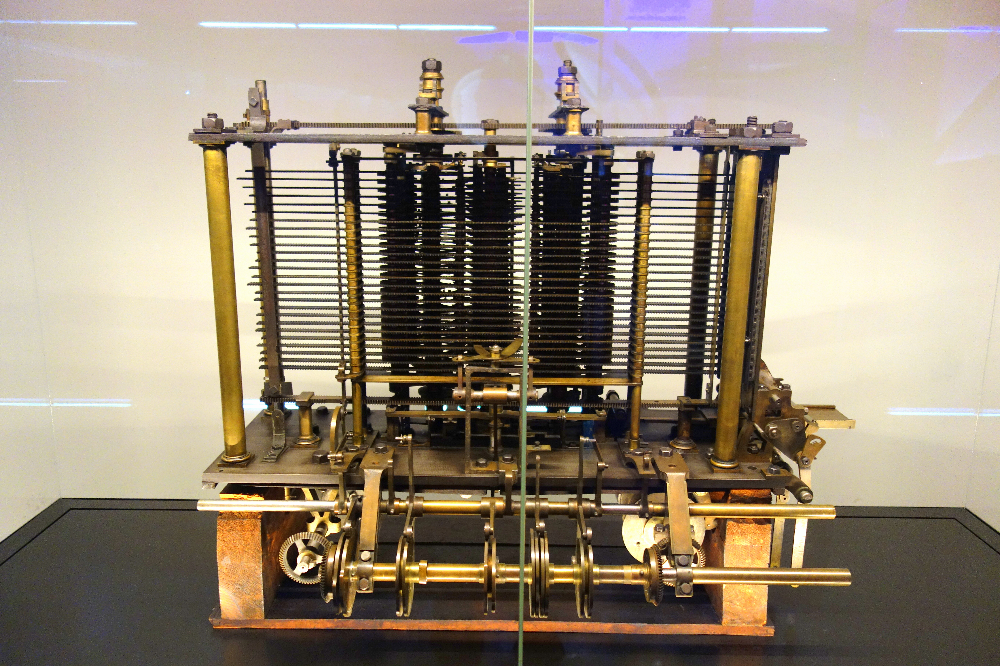
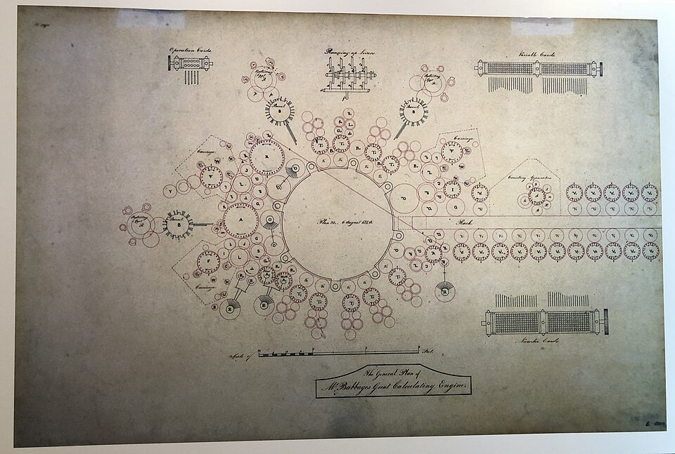
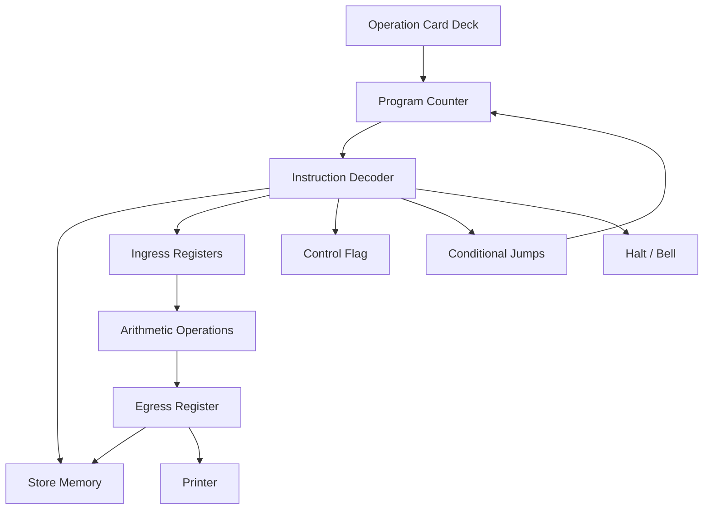

# ⚙️ Analytical-Machine Simulator

<p align="center">
  
</p>

<h3 align="center">A C-based simulation inspired by Charles Babbage's Analytical Engine</h3>

<p align="center">
  <i>Exploring the foundations of programmable computation through a modern software interpretation of a 19th-century machine.</i>
</p>

---

## Overview

The **Analytical Engine Simulator** is a small virtual machine written in C, inspired by the mechanical computing architecture envisioned by Charles Babbage and the algorithmic ideas of Ada Lovelace.

The project implements a simplified card-based computing system featuring a memory store, arithmetic registers, a control mechanism, and a small instruction set. Programs are written using a custom assembly-like language and executed by a simulated machine.

The goal is to explore the fundamental concepts of computation, including memory, arithmetic operations, instruction decoding, program counters, and conditional control flow, while paying tribute to the pioneers of computer science.

<p align="center">
  
</p>

---

## Table of Contents

- [Ada Lovelace](#-ada-lovelace)
- [Historical Background](#-historical-background)
- [Architecture](#-architecture)
- [Instruction Set](#-instruction-set)
- [Example Program](#-example-program--factorial-of-5)
- [How It Works](#-how-it-works)
- [Getting Started](#-getting-started)
- [Limitations](#-limitations)
- [Future Development](#-future-development)
- [References](#-references)
- [License](#-license)

---

# 👑 Ada Lovelace

<p align="center">
  
</p>

### Augusta Ada King, Countess of Lovelace

**10 December 1815 – 27 November 1852**

Augusta Ada King, Countess of Lovelace, widely known as Ada Lovelace, was an English mathematician and writer whose work became an important part of the history of computing. She is widely recognized for her pioneering work on Charles Babbage's proposed Analytical Engine and is often described as the first computer programmer.

Born in London in 1815, Ada was the daughter of the poet Lord Byron and Anne Isabella Milbanke. Her mother encouraged her education in mathematics, logic, and science, subjects that were rarely made accessible to women to the same extent during the 19th century.

Her intellectual interests extended beyond mathematics alone. Ada combined analytical thinking with imagination, developing an understanding of how mathematical ideas and mechanical systems could potentially be used to perform complex tasks.

### Her encounter with Charles Babbage

In 1833, Ada Lovelace met Charles Babbage, a mathematician and inventor working on mechanical computing machines. She became fascinated by his ideas, particularly the Analytical Engine, which was designed to be more flexible than earlier mechanical calculators.

The Analytical Engine was envisioned as a programmable machine capable of performing mathematical operations based on instructions supplied through punched cards.

### The 1843 Notes

In 1843, Lovelace published her translation of an article by Luigi Federico Menabrea describing Babbage's Analytical Engine. She added extensive notes of her own, which became considerably longer than the original article.

These notes included a detailed algorithm for calculating Bernoulli numbers, demonstrating how a sequence of instructions, variables and operations could be organized for execution by a machine.

Her work is often considered a foundational milestone in the history of programming.

### A vision beyond calculation

Lovelace recognized that machines could potentially manipulate symbols according to rules, rather than being limited to numerical calculations.

She considered the possibility that a machine could represent other forms of information, including musical or symbolic structures, if those representations could be expressed mathematically.

This idea was remarkably forward-looking for the technology of her time.

### Legacy

Ada Lovelace died in 1852 at the age of 36. Her contributions to the conceptual history of programming continued to be recognized long after her death.

In 1980, the United States Department of Defense named the Ada programming language after her.

Her work remains an important example of the intersection between mathematics, engineering, creativity, and computation.

---

# ⚙️ Historical Background

## Charles Babbage's Analytical Engine

<p align="center">
  
</p>

The Analytical Engine was a proposed mechanical general-purpose computer designed by Charles Babbage during the 19th century.

Unlike earlier calculating machines designed primarily for specific calculations, the Analytical Engine was conceived as a machine that could be programmed to perform different operations.

Its proposed architecture introduced concepts that are recognizable in modern computing:

- Memory for storing numbers.
- An arithmetic processing unit.
- Instructions controlling operations.
- Input through punched cards.
- Output through printing mechanisms.
- Conditional and iterative computation.

The full machine was never completed during Babbage's lifetime.

## Punched cards

<p align="center">
  
</p>

Babbage's design was influenced by the punched-card system used in Jacquard weaving machines.

Punched cards could encode instructions and information through patterns of holes. In the Analytical Engine, these cards were intended to control operations and specify variables.

This simulator takes inspiration from this concept by representing each instruction as an individual card in an execution deck.

<caption>Historical punched-card image: Karoly Lorentey / Wikimedia Commons, CC BY 2.0.</caption>

---

# 🏗️ Architecture

The simulator implements a simplified representation of several conceptual components of the Analytical Engine.

## Machine components

| Component | Implementation | Function |
|---|---|---|
| Store | `int64_t store[1000]` | Stores numbers and intermediate results. |
| Ingress 1 | `ingress1` | First arithmetic input register. |
| Ingress 2 | `ingress2` | Second arithmetic input register. |
| Egress | `egress` | Holds the result of arithmetic operations. |
| Run-Up Lever | `run_up_lever` | Boolean control flag set when the result of an arithmetic operation is positive. |
| Card Deck | `Card deck[]` | Contains the assembled program. |
| Program Counter | `pc` | Tracks the current instruction. |
| Printer | `OP_PRINT` | Outputs the egress register. |
| Bell | `OP_HALT` / error messages | Signals termination or certain execution errors. |

## Architecture diagram



## Machine state

The `AnalyticalEngine` structure represents the complete state of the simulated machine.

```c
typedef struct {
    int64_t store[STORE_SIZE];
    int64_t ingress1;
    int64_t ingress2;
    int64_t egress;
    int ingress_count;
    bool run_up_lever;
    int pc;
} AnalyticalEngine;
```

The machine operates using a shared memory store and two input registers.

Arithmetic instructions read the values held in the ingress registers, calculate a result, and write the result into the egress register. The control flag is updated based on whether the result is greater than zero.

---

# 🃏 Instruction Set

Each instruction represents a single card in the simulated deck.

| Instruction | Arguments | Description |
|---|---|---|
| `N` | `address value` | Writes a constant into a memory location. |
| `L` | `address` | Loads a value from memory into an ingress register. |
| `S` | `address` | Stores the egress value into memory. |
| `+` | None | Adds the two ingress values. |
| `-` | None | Subtracts the second ingress value from the first. |
| `*` | None | Multiplies the two ingress values. |
| `/` | None | Divides the first ingress value by the second. |
| `CF?` | `offset` | Conditional forward jump if the control flag is true. |
| `CB?` | `offset` | Conditional backward jump if the control flag is true. |
| `P` | None | Prints the egress value. |
| `H` | None | Halts execution. |

## Number card — `N`

```text
N 0 42
```

Writes the value `42` into memory location `0`.

## Load card — `L`

```text
L 0
L 1
```

Loads values from the Store into the ingress registers.

The simulator alternates between `ingress1` and `ingress2` when valid load instructions are executed.

## Store card — `S`

```text
S 0
```

Writes the current value of the egress register into memory location `0`.

## Arithmetic cards

```text
+
-
*
/
```

Arithmetic instructions operate on the values currently held in the ingress registers.

The result is stored in the egress register.

After an arithmetic operation:

```c
ae->run_up_lever = (ae->egress > 0);
ae->ingress_count = 0;
```

The control flag therefore indicates whether the latest arithmetic result is strictly positive.

## Conditional forward jump — `CF?`

```text
CF? 3
```

If the control flag is true, the program counter is adjusted to move forward through the deck.

## Conditional backward jump — `CB?`

```text
CB? 8
```

If the control flag is true, the program counter is adjusted to move backward through the deck.

These instructions enable loops and conditional execution.

## Printer — `P`

```text
P
```

Prints the current egress register value.

Example:

```text
PRINTER OUTPUT: 120
```

## Halt — `H`

```text
H
```

Stops the execution of the program and prints a simulated bell notification.

---

# 🧮 Example Program — Factorial of 5

The included program calculates the factorial of five:

\[
5! = 5 \times 4 \times 3 \times 2 \times 1 = 120
\]

## Program

```text
N 0 5
N 1 1
N 2 1
N 3 0

L 1
L 0
*
S 1

L 0
L 2
-
S 0
CB? 8

L 1
L 3
+
P
H
```

## Memory initialization

| Address | Initial value | Purpose |
|---|---:|---|
| `0` | `5` | Counter |
| `1` | `1` | Factorial accumulator |
| `2` | `1` | Decrement value |
| `3` | `0` | Zero value for final addition |

## Execution logic

```text
counter = 5
accumulator = 1

while counter > 0:
    accumulator = accumulator * counter
    counter = counter - 1

print(accumulator)
```

The program implements this logic using memory loads, arithmetic cards, a store instruction and a conditional backward jump.

## Execution trace

| Iteration | Counter | Accumulator |
|---|---:|---:|
| Initial | 5 | 1 |
| 1 | 4 | 5 |
| 2 | 3 | 20 |
| 3 | 2 | 60 |
| 4 | 1 | 120 |
| 5 | 0 | 120 |

## Expected output

```text
PRINTER OUTPUT: 120
BELL RINGS: Execution halted.
```

---

# 🔄 How It Works

## 1. Assembly

The program is defined as an array of text instructions.

The `assemble_line()` function parses each instruction and converts it into a `Card` structure containing:

- An opcode.
- The first argument.
- The second argument.

The resulting cards are stored in an instruction deck.

## 2. Initialization

`init_engine()` initializes the machine state:

- Memory is cleared.
- Registers are reset.
- The ingress counter is reset.
- The control flag is disabled.
- The program counter starts at zero.

## 3. Execution

`run_engine()` executes the instructions sequentially.

Each execution cycle:

1. Fetches the card at the current program counter.
2. Advances the program counter.
3. Decodes the opcode.
4. Executes the instruction.
5. Updates the machine state.
6. Continues until the machine halts, encounters a handled error, or the program counter leaves the deck boundaries.

## 4. Output

The printer outputs the egress register value.

The simulated bell is used to signal termination and certain execution errors.

---

# 🚀 Getting Started

## Requirements

- GCC, Clang or another compatible C compiler.
- C standard library.
- A terminal or command-line environment.

The source code uses standard C headers and is intended for a C11-compatible compiler.

## Clone the repository

```bash
git clone https://github.com/EngineGames-Development/AnalyticalEngine.git
cd AnalyticalEngine
```

<caption>Replace the repository URL above if your repository has a different name or location.</caption>

## Compile

### Linux

```bash
gcc -std=c11 -Wall -Wextra -O2 main.c -o analytical_engine
```

### Windows

```bash
gcc -std=c11 -Wall -Wextra -O2 main.c -o analytical_engine.exe
```

## Run

### Linux

```bash
./analytical_engine
```

### Windows

```bash
analytical_engine.exe
```

## Expected output

```text
PRINTER OUTPUT: 120
BELL RINGS: Execution halted.
```

---

# ⚠️ Limitations

This project is a simplified software simulation and is not a faithful mechanical reconstruction of Babbage's Analytical Engine.

Current limitations include:

- Fixed memory size of 1,000 signed 64-bit integer locations.
- Fixed instruction deck capacity of 256 cards.
- No floating-point arithmetic.
- No symbolic labels.
- No external program file loading.
- No interactive user input.
- No instruction-by-instruction debugger.
- No execution-step limit for infinite loops.
- Limited error handling.
- No mechanical timing simulation.
- No physical representation of gears, shafts or card mechanisms.
- The control flag only indicates whether the latest arithmetic result is positive.
- Arithmetic overflow is not explicitly handled.
- Invalid arithmetic cases such as division overflow are not fully handled.

The project focuses on computational concepts rather than historical mechanical accuracy.

---

# 🔮 Future Development

Potential extensions to the simulator:

- [ ] External `.ae` program files.
- [ ] Symbolic labels for jumps.
- [ ] A standalone assembler.
- [ ] An execution debugger.
- [ ] Step-by-step execution.
- [ ] Memory inspection.
- [ ] Register inspection.
- [ ] Execution tracing.
- [ ] Arithmetic overflow handling.
- [ ] Execution-step limits.
- [ ] Improved error handling.
- [ ] Interactive input cards.
- [ ] Graphical machine visualization.
- [ ] Instruction execution animations.
- [ ] A more historically inspired instruction set.
- [ ] Unit tests for all instructions.
- [ ] Ada Lovelace's Bernoulli-number algorithm.
- [ ] Decimal-column arithmetic inspired by Babbage's original design.

---

# 📚 References

- [Ada Lovelace — Encyclopaedia Britannica](https://www.britannica.com/biography/Ada-Lovelace)
- [Ada Lovelace — UNESCO](https://www.unesco.org/en/virtual-science-museum/women-science/ada-lovelace)
- [Charles Babbage's Analytical Engine — Computer History Museum](https://www.computerhistory.org/babbage/engines/)
- [Analytical Engine — Encyclopaedia Britannica](https://www.britannica.com/technology/Analytical-Engine)
- [Ada Lovelace — Oxford Bodleian Libraries](https://blogs.bodleian.ox.ac.uk/adalovelace/)
- [Punched Cards for the Analytical Engine — Wikimedia Commons](https://commons.wikimedia.org/wiki/File:PunchedCardsAnalyticalEngine.jpg)

---

# 📜 License

This project is intended to be distributed under the **MIT License**.

See the `LICENSE` file for the complete license text.

---

<p align="center">
  <i>Inspired by the pioneering ideas of Ada Lovelace and Charles Babbage.</i>
</p>

<p align="center">
  <b>Analytical Engine Simulator — Exploring the foundations of programmable computation.</b>
</p>
